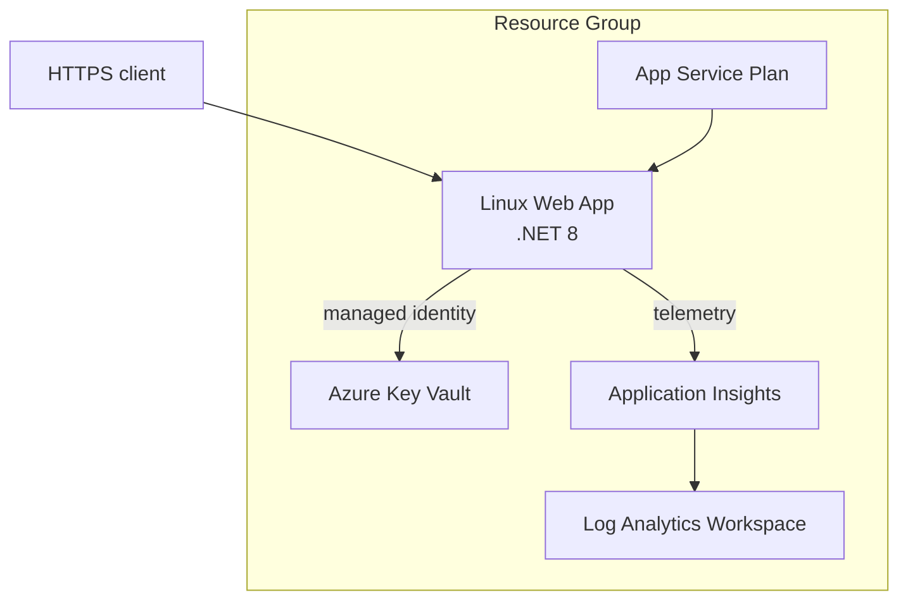

# Architecture

This repository expresses the same small Azure application platform in Bicep and Terraform. Choose one implementation per environment; do not apply both to the same resource group.

## Design decisions

- **Two equivalent implementations:** Bicep demonstrates Azure-native modularity; Terraform demonstrates provider-based, stateful IaC.
- **Managed identity and RBAC:** the Web App receives a system-assigned identity and the least-privilege `Key Vault Secrets User` role. No application secret is stored in source.
- **Workspace-based monitoring:** Application Insights sends telemetry to Log Analytics for centralized querying and retention.
- **Environment-aware compute:** non-production uses B1; production uses P0v3. Teams should tune SKU, scale, and availability requirements before production.
- **Globally unique names:** Bicep derives a deterministic suffix. Terraform requires an explicit suffix so naming remains predictable across state migrations.
- **Safe CI:** pull requests compile Bicep and statically validate Terraform. CI never authenticates to Azure or applies infrastructure.

## Production hardening

For a production workload, add private endpoints and private DNS for Key Vault, restrict App Service ingress, configure diagnostic settings and alerts, use deployment slots, define autoscale, apply Azure Policy, and keep Terraform state in a locked and versioned Azure Storage backend.
